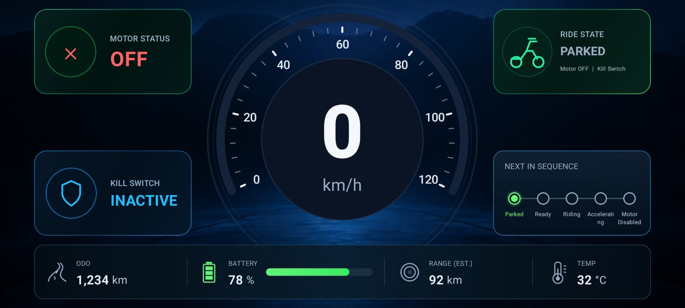
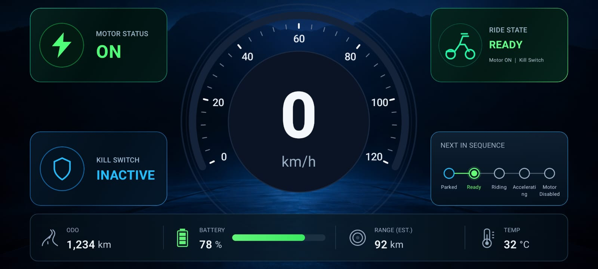
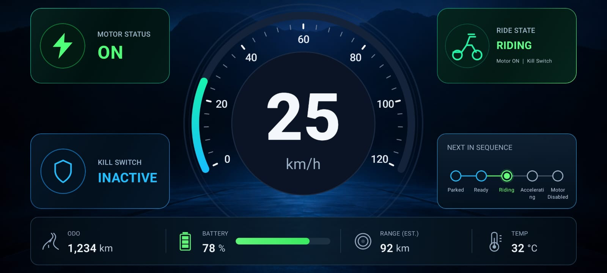
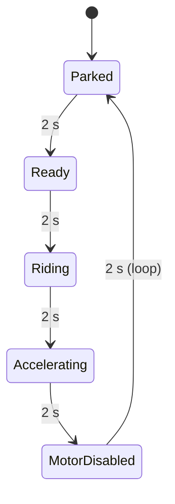

# E-Bike Dashboard

A landscape Android dashboard for an electric two-wheeler, written in Kotlin with Jetpack Compose. It shows speed, motor status, kill-switch status, the current ride state and a row of vehicle metrics (odometer, battery, range, temperature). There is no hardware, CAN or backend behind it: a simulated data source emits a repeating sequence of five ride states, and the UI is a pure function of the state the ViewModel exposes.

The project was built for the Android HMI Developer L1 technical assignment. The app is named "V Dash" on the device; the application id is `com.myworkshopy.vdash`.

## Screenshots

<table>
  <tr>
    <td align="center"></td>
    <td align="center"></td>
    <td align="center"></td>
  </tr>
  <tr>
    <td align="center"><b>Parked</b><br>0 km/h, motor OFF</td>
    <td align="center"><b>Ready</b><br>0 km/h, motor ON</td>
    <td align="center"><b>Riding</b><br>25 km/h, motor ON</td>
  </tr>
</table>

## Features

- Speedometer with a 0 to 120 km/h arc and a large numeric readout. The arc animates between values; speeds above 120 are clamped for drawing.
- Motor status card, ON or OFF, with a different icon and colour for each.
- Kill-switch card, ACTIVE or INACTIVE, with different colours.
- Ride state card (Parked, Ready, Riding, Accelerating, Motor Disabled) with a one-line summary of motor and kill-switch status.
- "Next in sequence" step indicator that follows the current ride state.
- Metrics bar: odometer, battery (with a bar), estimated range and temperature. These four values are hard-coded in `HomeScreen.kt` (1,234 km, 78 %, 92 km, 32 °C) and do not come from the simulator.
- Fallback screens for missing or stale data, and a warning banner for invalid speed (see [Edge cases](#edge-cases)).
- Landscape only (`android:screenOrientation="landscape"`), system bars hidden, content scaled to fit a 1120 x 544 dp design canvas.

## Ride sequence

`SimulatedVehicleRepository` builds a list of five `VehicleUiState` values and emits them in order, waiting 2 seconds after each one, then starts over. The sequence loops for as long as the flow is collected.

| Ride state | Speed | Motor | Kill switch |
|---|---|---|---|
| Parked | 0 km/h | OFF | Inactive |
| Ready | 0 km/h | ON | Inactive |
| Riding | 25 km/h | ON | Inactive |
| Accelerating | 50 km/h | ON | Inactive |
| Motor Disabled | 0 km/h | OFF | Active |



### Kill switch and motor behaviour

Ride state, motor flag, kill-switch flag and speed all arrive together in each sample. Nothing derives one from another. In the simulated sequence the kill switch is only active in the Motor Disabled sample, where the motor is off and speed is 0.

The ViewModel does not force speed to zero when the motor is off or the kill switch is active; it shows whatever speed the source reports, because a vehicle can coast. This is covered by a unit test (`motorOffDoesNotForceCoastingSpeedToZero`).

### Edge cases

The ViewModel tracks a `SignalStatus` (`WAITING`, `LIVE`, `STALE`, `UNAVAILABLE`) next to the vehicle values.

- Negative speed: clamped to 0 and flagged with `speedWasInvalid`. The dashboard shows "Invalid speed received • showing 0 km/h" until a valid sample arrives.
- No data yet: the status starts as `WAITING`. If no sample arrives within 3 seconds it becomes `UNAVAILABLE`, and the first sample recovers it.
- Stale data: a watchdog is restarted on every sample. If 3 seconds pass without one, the status becomes `STALE` and the dashboard shows "SIGNAL LOST" with placeholder values. The next sample returns it to `LIVE`.
- Source failure: if the repository flow throws or completes, the status becomes `UNAVAILABLE` and stays there. Coroutine cancellation is rethrown, not treated as a failure.

Only a `LIVE` status renders the full dashboard. Every other status renders the placeholder panel, so the app does not show old readings as current.

## Architecture

```
SimulatedVehicleRepository  ->  VehicleViewModel  ->  Dashboard (Compose)
   Flow<VehicleUiState>        StateFlow<VehicleUiState>   collectAsStateWithLifecycle()
```

- `repository/VehicleRepository` is the interface: `fun observeVehicleState(): Flow<VehicleUiState>`.
- `repository/SimulatedVehicleRepository` implements it with a `flow { ... }` loop and `delay`.
- `viewmodel/VehicleViewModel` collects the repository flow in `viewModelScope`, sanitises each sample, runs the staleness watchdog and exposes a read-only `StateFlow<VehicleUiState>`.
- `view/` contains the composables. `Dashboard` collects the state; `DashboardContent` takes a plain `VehicleUiState`, which keeps it previewable and testable.
- `di/VehicleModule` is a Hilt module that provides the repository as a singleton, so a real data source can replace the simulator in one place.

It is a single Gradle module (`:app`).

## Tech stack

| Item | Version (from the build files) |
|---|---|
| Kotlin | 2.4.21 |
| Android Gradle Plugin | 9.3.3 |
| Gradle wrapper | 9.8.0 |
| Compose BOM | 2026.09.00 (Material 3) |
| Activity Compose | 1.13.0 |
| Lifecycle Runtime KTX | 2.11.0 |
| Hilt / hilt-navigation-compose | 2.60.1 / 1.4.0 |
| KSP | 2.3.12 |
| compileSdk / targetSdk / minSdk | 37 / 35 / 24 |
| Java source and target compatibility | 11 |
| Unit tests | JUnit 4.13.2, kotlinx-coroutines-test 1.11.0 |

Coroutines and Flow drive the data layer, and the ViewModel holds state in a `MutableStateFlow`.

## Project structure

```
.
├── app/
│   └── src/
│       ├── main/java/com/myworkshopy/vdash/
│       │   ├── MainActivity.kt
│       │   ├── VehicleHmiApplication.kt      # @HiltAndroidApp
│       │   ├── di/VehicleModule.kt
│       │   ├── model/VehicleUiState.kt       # VehicleUiState, RideState, SignalStatus
│       │   ├── repository/
│       │   │   ├── VehicleRepository.kt
│       │   │   └── SimulatedVehicleRepository.kt
│       │   ├── viewmodel/VehicleViewModel.kt
│       │   ├── view/                         # HomeScreen, SpeedoMeter, cards, MetricsBar
│       │   └── ui/theme/
│       ├── test/java/com/myworkshopy/vdash/
│       │   ├── VehicleViewModelTest.kt
│       │   └── ExampleUnitTest.kt
│       └── androidTest/                      # template ExampleInstrumentedTest only
├── docs/screenshots/                         # ready.png, riding.png, parked.png
├── gradle/libs.versions.toml                 # version catalog
├── build.gradle.kts
└── settings.gradle.kts
```

## Getting started

### Prerequisites

- Android Studio recent enough to support Android Gradle Plugin 9.3.3 (check the AGP release notes for the exact minimum).
- Android SDK Platform 37 and the SDK build tools installed through the SDK Manager.
- A JDK for the Gradle daemon. `gradle/gradle-daemon-jvm.properties` asks for JDK 25, and the Foojay toolchain resolver in `settings.gradle.kts` downloads it if it is missing. The first build therefore needs network access.
- An emulator or device running Android 7.0 (API 24) or newer.

### Clone and run

```bash
git clone https://github.com/Markhande/-E-Bike-Dashboard.git
cd -E-Bike-Dashboard
```

If your shell treats the leading hyphen as an option, use `cd ./-E-Bike-Dashboard`.

1. Open the folder in Android Studio and wait for Gradle sync to finish. Studio writes `local.properties` with your SDK path.
2. Create or select an emulator and run it in landscape. The layout is drawn on a fixed 1120 x 544 dp canvas and scaled to the screen.
3. Run the `app` configuration. The simulation starts on launch.

### Command line

```bash
./gradlew assembleDebug      # APK in app/build/outputs/apk/debug/
./gradlew installDebug       # install on a connected device or running emulator
```

### Unit tests

```bash
./gradlew test               # runs both test classes
./gradlew testDebugUnitTest --tests "com.myworkshopy.vdash.VehicleViewModelTest"
```

`VehicleViewModelTest` runs on the JVM with a `StandardTestDispatcher` and virtual time, so the 2- and 3-second timings do not slow it down. It covers:

- the full five-state sequence, the 2-second spacing and the loop back to Parked
- negative speed being clamped, and the warning clearing on the next valid sample
- motor OFF not forcing a non-zero speed to zero
- stale-signal detection, recovery, and the watchdog restarting on each sample
- `WAITING` turning into `UNAVAILABLE` with no data, and recovering
- a throwing repository flow, and a completed flow, both ending as `UNAVAILABLE`
- clearing the ViewModel cancelling the simulation without reporting a failure

`ExampleUnitTest` and `ExampleInstrumentedTest` are the unmodified Android Studio templates.

## Using the app

Launch it in landscape and leave it alone. Every 2 seconds the speedometer, motor card, kill-switch card, ride state card and step indicator change together, going Parked, Ready, Riding, Accelerating, Motor Disabled and back to Parked. There are no controls.

To see the fallback screens, change the repository (for example, return an `emptyFlow()` from `observeVehicleState()` in `VehicleModule`) and run again. The Compose previews in `HomeScreen.kt` also include a "Signal lost" preview.

## Assignment checklist

| Requirement | How it is met |
|---|---|
| Landscape Android HMI dashboard | Activity locked to landscape in the manifest |
| Speedometer in km/h, auto-updating | `Speedometer`, fed by `VehicleUiState.speed` |
| Motor ON/OFF clearly shown | `MotorStatusCard`, plus the ride state summary |
| Kill switch Active/Inactive, distinct visuals | `KillSwitchCard`, colour changes with state |
| Reactive UI, no manual refresh | `StateFlow` collected with `collectAsStateWithLifecycle()` |
| Simulated data via Coroutines and Flow | `SimulatedVehicleRepository` emits a `Flow<VehicleUiState>`; see the note on timing below |
| Five scenarios | Parked, Ready, Riding, Accelerating, Motor Disabled, looping |
| Kotlin, Compose, ViewModel | All UI is Compose; state lives in `VehicleViewModel` |
| UI / ViewModel / data provider separated | `view/`, `viewmodel/`, `repository/` in one module |
| At least two edge cases | Negative speed, missing data, stale data, source failure |
| At least two unit tests | Eight tests in `VehicleViewModelTest` |
| README with build, architecture, assumptions, tests | This file |

## Assumptions and limitations

- The simulator emits one sample every 2 seconds. The assignment asks for roughly one per second.
- The 3-second stale threshold is a constant in the ViewModel (`STALE_AFTER_MS`), chosen to sit above the 2-second emission interval.
- Odometer, battery, range and temperature are fixed values, not simulated or validated.
- Ride state is supplied by the data source. The ViewModel does not check that it agrees with speed, motor and kill-switch values.
- Hilt is used for injection. The assignment lists dependency injection as optional.
- The layout follows the reference image from the assignment for visual guidance only and does not implement every feature in it.
- The unit tests are local JVM tests only. No Compose UI tests have been written.

## Possible improvements

- Emit at 1 Hz, or make the interval a constructor parameter.
- Feed the metrics bar from the same data source and add validation for battery and temperature.
- Cross-check ride state against motor, kill switch and speed in one place.
- Add Compose UI tests for the fallback panels and the warning banner.
- Stop tracking `local.properties` and the `build/` reports with a root `.gitignore`.

## Author

Hemant Markhande, [github.com/Markhande](https://github.com/Markhande)
